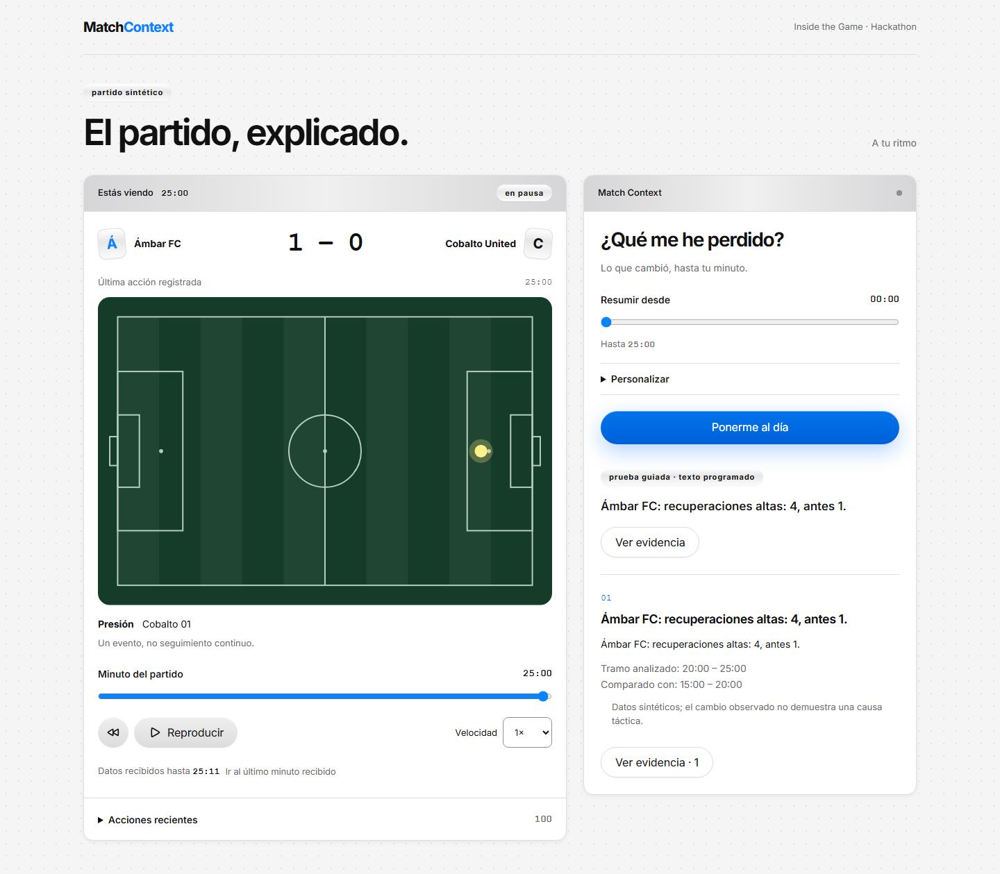

# Fan viewer: task 6

## Current studio refinement (24 October)

The user-approved Estudio de partido design supersedes the earlier Heyclicky appearance described in historical notes below. The visible provisional English identity is **Touchline**, with a local generated abstract sequence mark and self-hosted IBM Plex Sans. Backend names, identifiers and storage keys remain stable.

The studio adds a compact match strip, anchored event annotation, native playback ruler, chronological latest-three shortcuts, result-bound shot comparison and responsive evidence drawer. Shot facts must match the context snapshot, cutoff and full requested sequence interval; missing, invalid or mismatched facts omit the chart. No totals are borrowed from the broader view.

Fresh verification after the final annotation correction: **40 unit tests passed**, **12 real HTTP/SQLite browser tests passed in one minute** across desktop/mobile, build passed, API type drift and formatting passed. Tests include normal/reduced motion, focus return, finite240ms drawer transition, immediate stale-data removal, correction availability, slow bounded reads, fonts, axe page/dialog scans and320px reflow. The unchanged backend suite retains its previous255-test result; it was not rerun for this frontend change.

Actual factual-mode captures are in [studio-2026-10-24](evidence/studio-2026-10-24/01-escritorio.png), with mobile, evidence and preferences alongside them. Both captures use snapshot `m-c7261c37c40ffd45:269:0a88c78b70eb0690`, paused25:00, score1–0 and zero model calls. Console/page errors were empty. The known ingestion head is90:00; that is received metadata, not a future match score. See [design QA](../design-qa.md) for explicit visual adaptations, including the real105×68 field geometry and readable mobile caption.

No Azure provisioning, external deployment or real-model quality claim is part of this refinement.

An independent review of `692c483..0bbc9e1` found no actionable Critical, Important or Minor issues. It inspected the surrounding invalidation/evidence flow and actual desktop/mobile captures and independently passed28 focused ShotComparison/Timeline/Viewer tests. No additional fix pass was needed.

The React/Vite/TypeScript fan experience consumes the existing temporal API. It shows the score known at the selected minute, one recorded event on an SVG pitch, recent events, a missed-segment recap and optional supporting evidence. Spanish/English, simple/detailed output and favorite-team preferences feed the same backend context request.

The local product is runnable; deployment, professional briefings and evaluation with real users remain separate work. The current frontend tests use factual or explicitly scripted output. They do not establish new Foundry narrative quality, latency or cloud readiness.

## Reproduce

Install Python API development dependencies as described in the README. In `web/`:

```powershell
npm.cmd ci
npm.cmd test -- --run
npm.cmd run api:check
npm.cmd run build
npx.cmd playwright install chromium
npm.cmd run test:e2e -- fan.spec.ts
```

Playwright starts a real loopback Uvicorn API with temporary SQLite, seeded synthetic events, independent ingestion and explicitly injected scripted agents. It owns ports 8765 and 5173 and refuses to reuse existing services. No Azure keys, sign-in or model calls are required. Set `E2E_PYTHON` to a Python executable if the repository `.venv` is elsewhere. Browser reports/screenshots/traces stay in ignored `tmp/ui-validation/`.

For manual use, start `match_context.server` in factual or explicitly configured Foundry mode on port 8000, then `npm.cmd run dev` in `web/`. `MATCH_CONTEXT_API` can select another development proxy target. The eventual static production server/container is task 8.

## Temporal behavior and decisions

- Start paused at zero; only static match metadata is preloaded. The shared head exposes received time without the current score. Every selected second resolves a cursor before fetching a bounded view. There is no fixture download, ingestion write route or full-match browser store.
- Seeking clears the old score, pitch, events, context and open evidence immediately. Both abort and local increasing request keys reject late cursor/view/context completions. Cached server trace IDs are never client request keys.
- Generating pauses local playback so the request refers to a stable missed segment. Seeking or changing language/detail/team/start invalidates it; changing a preference preserves the selected minute. Pause/speed do not mutate or stop shared ingestion.
- Automatic playback buffers while its selected frame is loading. Slow reads reduce achieved playback speed, rather than being repeatedly cancelled by the one-second timer. Deliberate seeks, including rewinds, still clear/cancel immediately.
- Evidence uses the immutable context snapshot and cutoff, loads on demand in batches of at most 100 requested IDs, validates snapshot identity and cancels/ignores late responses when closed. Source dependencies may legitimately include more events. Units, intervals, sample sizes and caveats remain visible. Escape/back returns focus and retains playback time.
- Only validated preferences go to localStorage. Storage failure/private mode is tolerated; neither match data, generated narrative nor playback cursor is persisted there. Reload starts at zero.
- API reads time out after 15 seconds and context requests after 30 seconds; these browser limits do not alter backend model budgets. A pending recap has cancellation and a slower-than-usual message after ten seconds. The backend's factual fallback is kept distinct from reviewed model narrative and guided scripted tests. No streamed partial text is produced by this API.

## Design and accessibility

[Design provenance and adaptations](../DESIGN.md). Actual Heyclicky Button/Card/Badge/Dialog/NativeSelect components are used; field geometry is data visualization. Inter is local, and all application icons are MingCute line. The primary gradient and small blue indices were darkened after contrast checks. A real scrollability failure in evidence was fixed with a named, focusable scroll region.

Checks include desktop and 390px mobile Chromium, 320px reflow, page/dialog axe scans, native keyboard time control, Escape and focus return, reduced motion, font loading, network request boundaries and preferences-only localStorage. Rendered spacing is captured at 390/1440/1728px. Text-comprehension checks cover the actual playback, catch-up and evidence navigation panels; they are heuristics, not user research.

No NVDA/VoiceOver session, Safari/Firefox run, load/latency study or real-user usefulness session has been performed. Those claims are intentionally absent.

## Verification record

- Full pinned Python suite: **255 passed, one opted-in live test skipped**, warnings as errors, 98.55 seconds. No Python production behavior changes in this branch.
- Vitest after the review fix pass: **23 passed**. Includes delayed/out-of-order transport completions even after abort, cached trace reuse, rewind clearing, language/cursor preservation, focus return, cancellation, slow runs, head-poll serialization, timeout recovery, read buffering, bilingual metric units and definitions.
- Real HTTP/SQLite Playwright suite after the fix pass: **eight passed**, 47.4 seconds, covering desktop and 390px mobile. The new regression delays bounded views by 1,200ms, longer than the one-second timer, and proves frames still complete during playback. Page and open-dialog axe scans report zero violations under the selected WCAG A/AA tags. Spanish/English, evidence bounds, independent ingestion, native keyboard playback, 320px reflow and preference-only storage are checked.
- Build, dependency consistency, formatting, exported OpenAPI and generated immutable TypeScript drift checks pass. The original Windows CRLF-only schema check failure was reproduced, normalized bytes were identical, and generated-file LF checkout rules make regeneration/check reproducible.
- Better Design measured 390/1440/1728px: zero Critical/Serious geometry findings. Seven moderate heuristics concern intentional fluid auto margins, a 24px column gutter and full-width window borders with separate content padding; interpretation is recorded in `DESIGN.md`. This is not a claim of a perfect tool score or user-validated layout.
- A fresh independent whole-branch reviewer independently passed the original20 unit tests, six browser journeys, build, types and formatting. It found no Critical, one Important slow-read playback defect and two evidence issues initially labeled Minor (English shot-quality unit and missing supplied definition). The evidence issues were treated together as an Important interpretability gap: an arbitrary heuristic without its scale/method is not an adequate explanation for a fan. All were fixed in one pass, with failing regressions observed before fixes; no second reviewer was dispatched.
- A clean dependency install/build succeeds. API drift also passes in an archive taken from the repository root, including its checkout attributes. A `HEAD:web` subtree archive omits the parent `.gitattributes` and converts line endings on this Windows host; that incomplete archive is not the reproducible checkout procedure.

Rendered examples use the clearly labeled scripted test backend:



[Mobile fan view](evidence/fan-mobile.png)

Review boundaries: unchanged backend chronology/storage/agent/HTTP behavior retains prior review and the passing255-test suite. New real Foundry/browser evaluation, Azure deployment/identity/load, professional exports, usefulness sessions, other browsers/screen readers and the exhaustive four-scenario/two-viewer matrix remain later checks. Cutoff-aware playback does not claim protection against a user deliberately requesting already-ingested future public synthetic data or tampering with trusted API JSON.

## Licenses

Heyclicky components and tokens were obtained through the user-selected [Better Design kit](https://better-design.com/design-systems/heyclicky). [MingCute source and Apache 2.0 license](https://github.com/mingcute-design/mingcute-icons/blob/main/LICENSE) and Inter's SIL Open Font License are copied to `web/public/licenses/` for distribution. npm package licenses remain with their dependencies. No real football assets are included.

## Visual personality refinement

The follow-up request asks for a deliberate, lively football interface. The refined scoreboard has a compact broadcast treatment and original typographic club marks; the selected Heyclicky controls remain. All four added action/football/settings/navigation SVGs come from the same MingCute line collection and are bundled locally.

Native SVG/CSS was selected after comparing [Motion SVG animation](https://motion.dev/docs/react-svg-animation), [Rive's React runtime](https://github.com/rive-app/rive-react) and the available Motion Primitives catalog. Finite path/arrival, recap entrance and press/hover effects fit the current scope without another animation runtime. [Reduced motion](https://developer.mozilla.org/en-US/docs/Web/CSS/Reference/At-rules/@media/prefers-reduced-motion) renders the complete static result. Scores stay exact, and rewinds remove outgoing data immediately.

The pitch and known team identities now stay mounted while a selected frame loads; the previous score, player and event do not. Three recent-action shortcuts come only from the bounded event tail and navigate by availability time, preserving delayed-correction chronology. Repeated reads of the same event do not replay its entrance cue.

Refinement verification: **27 unit tests passed**, including correction availability and neutral loading; **10 real HTTP/SQLite browser tests passed in 57.7 seconds**, including normal/reduced motion and a rewind while the prior action could still be animating. Page/dialog axe scans remain clear on desktop/mobile, with 320px reflow and existing temporal/network/storage checks retained. Build/types/format pass. The backend is unchanged; no model requests were made.

Before/after screenshots at the same second 1500 and 1440/390 widths were captured and inspected. Additional rendered captures cover 1728px. Better Design's free query quota was exhausted after obtaining principles/references, so this refinement uses the previously retrieved rules and actual browser measurements; **no new MCP review receipt is claimed**. User usefulness, other browsers/screen readers and real Foundry evaluation remain the stated later checks.

Independent refinement review (`3628803..80359f8`) found no Critical/Important defects and two Minor observations: focus was dropped when a shortcut unmounted, and the motion test did not guarantee an actively running animation at rewind. Focus loss was regraded as an interaction/accessibility issue and fixed: shortcuts deliberately transfer focus to the stable time slider before reloading. Its regression failed with BODY focused before the fix, then passed. The browser test now places the real CSS animation inside its timeline, confirms it is running and dispatches the rewind in the same task; it also verifies the old event node is disconnected. All 27 unit and 10 browser checks pass after this single fix pass, with no second reviewer.
